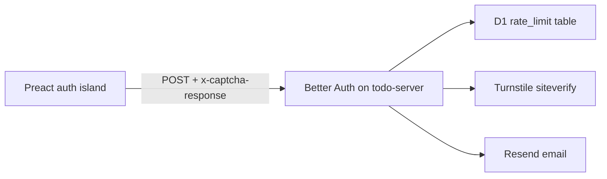

# Auth rate limiting + Turnstile (this stack)

Teaching guide for pre-auth abuse control on this Better-T-Stack monorepo: Better Auth rate limits on D1, Cloudflare Turnstile via the Better Auth captcha plugin, and Varlock/Alchemy env wiring.

Agent edit order: [AGENTS.md](../AGENTS.md). Local deploy/secrets: [ALCHEMY_SETUP.md](./ALCHEMY_SETUP.md). Better Auth security skill: [`.agents/skills/better-auth-security-best-practices/SKILL.md`](../.agents/skills/better-auth-security-best-practices/SKILL.md).

**Rule:** When an implementation uses test credentials or is local-only, always call out remaining **production step(s)**. Never imply the feature is fully live until real keys are deployed.

---

## 1. Part 1 vs Part 2 status

| Part                     | Status           | What it is                                                                                                                                          |
| ------------------------ | ---------------- | --------------------------------------------------------------------------------------------------------------------------------------------------- |
| **Part 1 — Development** | **Done in code** | D1-backed Better Auth `rateLimit`, captcha plugin, Preact Turnstile islands, Varlock/Alchemy env slots, Cloudflare **test keys** as schema defaults |
| **Part 2 — Production**  | **Done**         | Real Managed widget for `todo.sarl` / `www.todo.sarl`; real `PUBLIC_TURNSTILE_SITEKEY` + `TURNSTILE_SECRET_KEY` deployed via Alchemy                |

Part 1 makes local `pnpm run dev` exercise the full challenge + verify path without a dashboard widget. Part 2 is ops: real widget + real secrets + deploy. `createAuth` rejects Cloudflare’s always-pass test secret when `NODE_ENV=production`.

---

## 2. Why both layers

Rate limiting and Turnstile cover **different** attack vectors. Cloudflare’s guidance for login and sensitive forms is to use **both**.

| Layer                                     | Stops                                                  | Does not stop alone                                           |
| ----------------------------------------- | ------------------------------------------------------ | ------------------------------------------------------------- |
| **Rate limit** (per IP, Better Auth → D1) | High-volume abuse from one IP / subnet                 | Slow distributed bots, many IPs                               |
| **Turnstile** (human check + siteverify)  | Automated form / API submissions without a valid token | High volume of humans (or stolen tokens) without a volume cap |

Classic failure mode: embed a widget on the page but **never** validate the token on the server. The UI looks protected; the endpoint is not. Turnstile Spin exists largely to prevent that gap (see [§5](#5-turnstile-spin)).



Protected auth surfaces today:

| Surface                     | Endpoint                   | Turnstile        | Custom rate limit |
| --------------------------- | -------------------------- | ---------------- | ----------------- |
| Sign-in                     | `/sign-in/email`           | Yes              | 5 / 60s           |
| Sign-up                     | `/sign-up/email`           | Yes              | 3 / 60s           |
| Forgot password             | `/request-password-reset`  | Yes              | 3 / 60s           |
| Resend verification         | `/send-verification-email` | Yes              | 3 / 60s           |
| Reset password (token form) | `/reset-password`          | No (token-gated) | 5 / 60s           |

Config: [`packages/auth/src/index.ts`](../packages/auth/src/index.ts).

---

## 3. What is Varlock

[Varlock](https://varlock.dev) is how this monorepo declares, validates, and types environment variables. Agents and humans edit **schemas**, not secret values in chat.

### Source of truth: `.env.schema`

Committed schemas (safe to read/edit):

- [`apps/server/.env.schema`](../apps/server/.env.schema) — API Worker secrets/config (`TURNSTILE_SECRET_KEY`, auth, Resend, …)
- [`apps/web/.env.schema`](../apps/web/.env.schema) — public client vars (`PUBLIC_SERVER_URL`, `PUBLIC_TURNSTILE_SITEKEY`)
- [`packages/infra/.env.schema`](../packages/infra/.env.schema) — imports the picks Alchemy needs for deploy

Decorators you will see:

- `@sensitive` — treat as secret (mask in `varlock load`; do not paste into chat)
- `@public` — safe to expose (e.g. Turnstile sitekey)
- `@optional`, `@type=…`, `@docs(…)` — validation and docs hints
- Defaults in the schema (e.g. Turnstile **test** keys) — local/dev convenience only

Do **not** read or edit gitignored `.env` / `.env.local` for secrets. Use `varlock load` (masked) or have the human set values locally / in their secret store.

### Codegen

```bash
pnpm run env:generate
```

Regenerates typed `env.ts` files (e.g. [`apps/web/src/env.ts`](../apps/web/src/env.ts), [`apps/server/src/env.ts`](../apps/server/src/env.ts)).

### How values reach Workers

| Concern                     | Mechanism                                                                                           |
| --------------------------- | --------------------------------------------------------------------------------------------------- |
| Alchemy loads deploy inputs | `import "varlock/auto-load"` in [`packages/infra/alchemy.run.ts`](../packages/infra/alchemy.run.ts) |
| Server secret               | `TURNSTILE_SECRET_KEY: Redacted("TURNSTILE_SECRET_KEY")` on the API Worker                          |
| Web public sitekey          | `PUBLIC_TURNSTILE_SITEKEY: ConfigString("PUBLIC_TURNSTILE_SITEKEY")` on the Astro Worker            |
| Browser islands             | [`apps/web/src/env.public.ts`](../apps/web/src/env.public.ts) reads `import.meta.env.PUBLIC_*`      |
| Server runtime              | `cloudflare:workers` `ENV` → `createAuth(ENV, …)`                                                   |

[`packages/infra/.env.schema`](../packages/infra/.env.schema) imports `PUBLIC_TURNSTILE_SITEKEY` from [`apps/web/.env.schema`](../apps/web/.env.schema) (schema file, not the web directory) so deploy does **not** pick up [`apps/web/.env`](../apps/web/.env). For production, set the real sitekey in gitignored [`packages/infra/.env`](../packages/infra/.env) (or export it in the deploy shell). Server secrets still flow from [`apps/server/.env`](../apps/server/.env) via the directory `@import`.

There is **no** `wrangler.toml` / `wrangler.jsonc` for app secrets. Prefer Varlock + Alchemy over `wrangler secret put` for this project.

---

## 4. Part 1 — how “no widget” still worked

Nothing in Part 1 created a Turnstile widget in your Cloudflare account.

Local/dev works because the schemas default to Cloudflare’s **official always-pass test keys** ([testing docs](https://developers.cloudflare.com/turnstile/troubleshooting/testing/)):

| Role    | Test value (always passes)            |
| ------- | ------------------------------------- |
| Sitekey | `1x00000000000000000000AA`            |
| Secret  | `1x0000000000000000000000000000000AA` |

Those are public dummy credentials, not a dashboard widget. Production must replace them.

### Client (todo-web)

1. Load Turnstile from Cloudflare CDN (not the island JS bundle): [`apps/web/src/lib/auth/turnstile.ts`](../apps/web/src/lib/auth/turnstile.ts)
2. Explicit render in Preact: [`apps/web/src/components/islands/auth/turnstile-widget.tsx`](../apps/web/src/components/islands/auth/turnstile-widget.tsx)
3. On submit, send the token as header `x-captcha-response` (`CAPTCHA_RESPONSE_HEADER` from `@todo-task-app/auth/captcha`; Better Auth captcha contract), via `captchaFetchHeaders`
4. Forms: sign-in, sign-up, forgot-password, check-email resend — **not** reset-password
5. On captcha/auth error, remount the widget (`key` bump) so a fresh token is required

**CORS:** Hono on todo-server must include `CAPTCHA_RESPONSE_HEADER` in `cors({ allowHeaders })` ([`apps/server/src/index.ts`](../apps/server/src/index.ts)). Web and API are cross-origin; omitting that header fails the OPTIONS preflight and the auth form catch shows a generic error after Turnstile already succeeded.

### Server (todo-server / packages/auth)

Better Auth `captcha` plugin with `provider: "cloudflare-turnstile"` and `secretKey: env.TURNSTILE_SECRET_KEY`. Endpoints:

- `/sign-up/email`
- `/sign-in/email`
- `/request-password-reset`
- `/send-verification-email`

The plugin calls Cloudflare siteverify; missing/invalid tokens fail closed. Do **not** add a parallel Hono `/api/signup` siteverify for these flows.

IP for rate limits: `ipAddressHeaders: ["cf-connecting-ip"]` only — never list client-controlled `X-Forwarded-For`.

---

## 5. Turnstile Spin

[**Set up with Spin**](https://developers.cloudflare.com/turnstile/spin/) is a guided Cloudflare Turnstile flow (generally available August 2026). It creates a widget and helps wire the **full** integration: frontend embed **and** server-side verification.

### Why it helps

Turnstile always needs two steps:

1. Embed the widget (challenge on the form).
2. Call **siteverify** from the backend with the secret.

Without step 2, the widget appears but does not protect the request. Spin walks you through both and can validate the integration (including that token **replay** is rejected) before calling it done.

### What Spin does

When you select **Set up with Spin** on the Turnstile widgets page:

1. Asks for domains that may mint tokens (first often pre-filled from your account’s first active zone; `localhost` and `127.0.0.1` are added for local development).
2. Creates the widget and returns:
   - **Sitekey** (public — `data-sitekey` / `PUBLIC_TURNSTILE_SITEKEY`)
   - **Secret** (private — store as `TURNSTILE_SECRET_KEY`; never commit)
   - An **agent prompt** you can paste into an AI coding agent (Cursor, Claude Code, Codex, OpenCode, GitHub Copilot Chat). The prompt includes the sitekey and wiring instructions; it does **not** include the secret.
3. On the AI-agent path, the agent embeds the widget, wires siteverify into the backend, then validates with a real token and a replay check.

### Three ways to run Spin

All three can produce the same kind of Managed widget; they differ mainly in where create/wiring runs:

| Path                | How                                                                                                                       |
| ------------------- | ------------------------------------------------------------------------------------------------------------------------- |
| **Dashboard**       | Turnstile → **Set up with Spin** → domains → Set up                                                                       |
| **Wrangler CLI**    | `wrangler turnstile widget create "name" --domain example.com --mode managed` (prints sitekey + secret; you wire by hand) |
| **AI coding agent** | Paste the Spin prompt; agent loads the Turnstile Spin skill, creates the widget if needed, embeds, wires siteverify       |

The Spin skill includes insertion snippets for Next.js (App / Pages), Astro, SvelteKit, Hugo, and vanilla HTML. Other frameworks get a proposed pattern for confirmation first.

### Fix with Spin

The Turnstile dashboard can flag widgets that see embed traffic but **no matching siteverify** traffic (widget without backend). Those show **Fix with Spin** — a prompt aimed at adding the missing server verification.

### How to use Spin for Part 2 on _this_ repo

Part 1 already embedded the widget pattern and wired siteverify through Better Auth. For production:

1. Use Spin (or Wrangler / Add widget) to **create the widget and obtain keys**.
2. Put the secret in your deploy secret store / Varlock-backed env as `TURNSTILE_SECRET_KEY`.
3. Put the sitekey as `PUBLIC_TURNSTILE_SITEKEY`.
4. Deploy.

Do **not** let a Spin agent re-add a custom Hono `validateTurnstile` or rewrite the working Preact + Better Auth captcha path unless Fix with Spin shows a real missing-verification gap. Greenfield apps elsewhere can use Spin’s full agent path end to end.

---

## 6. Part 2 — production checklist

1. Create a Managed widget via **Set up with Spin** (preferred), dashboard Add widget, or Wrangler. Hostname management should include `todo.sarl`. Prefer Cloudflare **test keys** for local; avoid putting the production secret on a widget that also allows localhost unless you accept that tradeoff.
2. Override schema test defaults in production env:
   - `TURNSTILE_SECRET_KEY=<real secret>` in [`apps/server/.env`](../apps/server/.env)
   - `PUBLIC_TURNSTILE_SITEKEY=<real sitekey>` in [`packages/infra/.env`](../packages/infra/.env) (infra imports the web **schema** default, not `apps/web/.env`)
3. Deploy **server** and **web** Workers (`cd packages/infra && pnpm exec alchemy deploy --stage production --yes`). Production with the test secret will throw at `createAuth`.
4. Smoke-test sign-in, sign-up, forgot-password, and check-email resend; confirm a failed captcha remounts the widget.
5. Leave rate-limit rules unless abuse metrics say otherwise.

### Generic guides vs this stack

| Generic advice                                                                | Do this instead                                                                                |
| ----------------------------------------------------------------------------- | ---------------------------------------------------------------------------------------------- |
| Layout `<script>` + `<div class="cf-turnstile">` + form POST to `/api/signup` | Existing Preact explicit render + Better Auth client → `/api/auth/*` with `x-captcha-response` |
| `wrangler.jsonc` + `wrangler secret put`                                      | Varlock + Alchemy `Redacted` / `ConfigString`                                                  |
| Custom Hono siteverify helper                                                 | Better Auth `captcha` plugin (already configured)                                              |
| Trust `X-Forwarded-For`                                                       | `cf-connecting-ip` only                                                                        |
| Hardcode sitekey in HTML                                                      | `PUBLIC_TURNSTILE_SITEKEY` via `env.public.ts`                                                 |
| Turnstile on every password-reset UI                                          | Protect request/resend email paths; skip tokened reset-password form                           |

Test-key pairs ([docs](https://developers.cloudflare.com/turnstile/troubleshooting/testing/)):

| Behavior    | Sitekey                    | Secret                                |
| ----------- | -------------------------- | ------------------------------------- |
| Always pass | `1x00000000000000000000AA` | `1x0000000000000000000000000000000AA` |
| Always fail | `2x00000000000000000000AB` | `2x0000000000000000000000000000000AA` |

Tokens expire quickly and are single-use; validate immediately; reset the widget after failure.

---

## 7. Effective rate-limiting on this stack

1. **Enable explicitly** — `rateLimit.enabled: true` (do not rely only on prod defaults).
2. **Store in D1** — `storage: "database"` with the `rate_limit` table ([`packages/db/src/schema/auth.ts`](../packages/db/src/schema/auth.ts)). In-memory counters do not share across Cloudflare Worker isolates.
3. **Key by real client IP** — `cf-connecting-ip` only. Listing spoofable headers weakens limits.
4. **Tighten sensitive paths** with `customRules` (auth + outbound email). Keep human-usable windows (e.g. 3–5 attempts per 60s).
5. **Pair with Turnstile** on anonymous email/credential endpoints; rate limit alone is not enough against distributed bots.
6. **Map `TOO_MANY_REQUESTS`** in the UI ([`apps/web/src/lib/auth/auth-errors.ts`](../apps/web/src/lib/auth/auth-errors.ts)).
7. **Related pattern** — post-auth limits (e.g. avatar generate) can reuse the same D1 `rate_limit` table with app-defined keys; that is separate from Better Auth path rules.

Better Auth docs: [Rate Limit](https://www.better-auth.com/docs/concepts/rate-limit). Captcha plugin: [Captcha](https://www.better-auth.com/docs/plugins/captcha).

---

## 8. Repeatable checklist (new protected endpoint)

Use when adding another pre-auth or abuse-sensitive path:

1. Decide: Turnstile + rate limit, or rate limit only (token-gated / low abuse value).
2. Env — add or reuse Varlock entries; `pnpm run env:generate`; Alchemy bindings if new.
3. Server — extend Better Auth `captcha.endpoints` and/or `rateLimit.customRules` in [`packages/auth`](../packages/auth/src/index.ts). Prefer the captcha plugin over ad-hoc siteverify for auth routes.
4. Client — embed `TurnstileWidget`, send `x-captcha-response`, remount on failure; keep CDN script out of the island bundle (island size budget).
5. Errors — map captcha / `TOO_MANY_REQUESTS` codes to product copy.
6. **Production** — real widget (Spin/dashboard/Wrangler) + real keys + deploy; never ship test secrets when `NODE_ENV=production`.

---

## 9. Pointers

- [Cloudflare Turnstile testing](https://developers.cloudflare.com/turnstile/troubleshooting/testing/)
- [Turnstile Spin](https://developers.cloudflare.com/turnstile/spin/)
- [Stop account takeover attacks](https://developers.cloudflare.com/use-cases/solutions/stop-account-takeover-attacks/)
- [Better Auth rate limit](https://www.better-auth.com/docs/concepts/rate-limit) · [captcha plugin](https://www.better-auth.com/docs/plugins/captcha)
- [ALCHEMY_SETUP.md](./ALCHEMY_SETUP.md) — local auth URLs and deploy secrets
- Cloudflare plugin **turnstile-spin** skill — when running the full AI-agent Spin path on a greenfield integration
