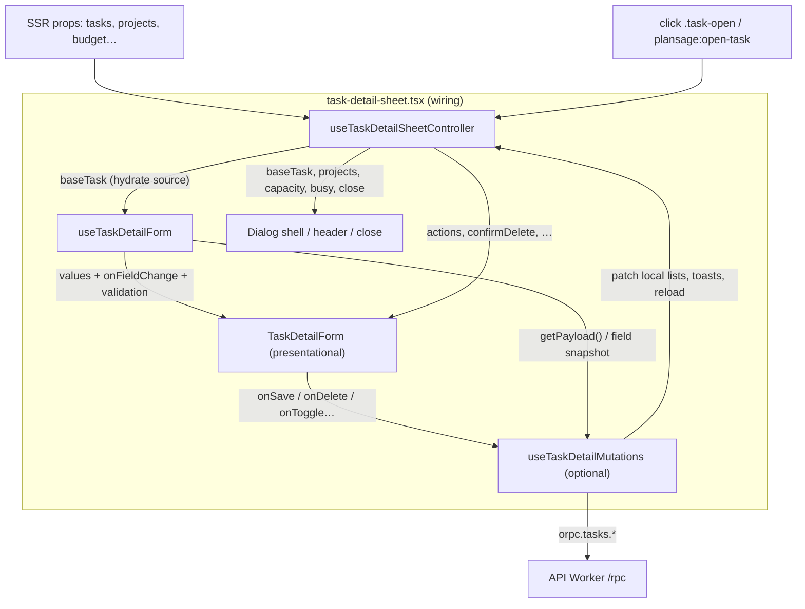

# Controller + form + presentational (Clean Code islands)

A practical guide for splitting heavy Preact islands into **controller hook**, **form hook**, and **presentational form**. Worked example: the Plansage **task detail sheet** (today a single god component; target modules listed below).

Product rules: [PRD.md](./PRD.md). Agent edit order: [AGENTS.md](../AGENTS.md). CRUD vertical slice: [ADDING_CRUD.md](./ADDING_CRUD.md). Lint / island standards: [`.agents/skills/ultracite/SKILL.md`](../.agents/skills/ultracite/SKILL.md).

**Status:** Implemented for the task detail sheet — see [`task-detail-sheet.tsx`](../apps/web/src/components/islands/task-detail-sheet.tsx) (wiring), [`use-task-detail-sheet-controller.ts`](../apps/web/src/lib/use-task-detail-sheet-controller.ts), [`use-task-detail-form.ts`](../apps/web/src/lib/use-task-detail-form.ts), [`use-task-detail-mutations.ts`](../apps/web/src/lib/use-task-detail-mutations.ts), and [`task-detail-form.tsx`](../apps/web/src/components/islands/task-detail-form.tsx).

---

## 1. Problem this pattern solves

Interactive sheets and boards start small and accrete:

- Open / close, focus traps, custom DOM events
- Local caches of SSR props (`localTasks`, `localProjects`)
- Dozens of form fields synced from a selected entity
- Validation, dirty checks, confirm-delete UX
- oRPC mutations, optimistic UI, toasts, celebrations, reloads
- Markup for every control

When all of that lives in one island file, you get a **god sheet**: hard to read, risky to change, and awkward to test. A one-line copy tweak can sit next to a race in `toggleCompleted`. Field resets collide with mutation `finally` blocks. New contributors cannot tell which `useState` is “sheet chrome” vs “form value” vs “in-flight flag.”

The pattern fixes that by giving each concern a named home and a narrow public surface. The island file becomes **thin wiring**: call hooks, pass props, render shell + form.

---

## 2. Mental model

Three layers (plus an optional mutations hook). Each **owns** one job and **must not own** the others.

| Layer | Module (task detail) | Owns | Must not own |
|-------|----------------------|------|--------------|
| **Controller hook** | [`use-task-detail-sheet-controller.ts`](../apps/web/src/lib/use-task-detail-sheet-controller.ts) | Sheet lifecycle: which task is open, open/close, document/`plansage:open-task` listeners, focus-progress scroll, local list caches, capacity / quadrant **derived** display inputs, confirm-delete chrome, busy aggregation for the shell | Field values (`title`, `notes`, …); raw JSX for inputs; direct `orpc.*` calls if you extracted mutations |
| **Form hook** | [`use-task-detail-form.ts`](../apps/web/src/lib/use-task-detail-form.ts) | Editable field state, reset/hydrate from `baseTask`, field change handlers, client validation (“title required”), packing a save payload | Sheet open state; event listeners; toasts; `location.reload`; markup |
| **Mutations hook** (optional fourth) | [`use-task-detail-mutations.ts`](../apps/web/src/lib/use-task-detail-mutations.ts) | `isSaving` / `isDeleting`, `orpc.tasks.update` / `delete`, error strings for alerts, toast + celebrate + reload side effects, optimistic list patches | Form field storage; dialog chrome layout |
| **Presentational form** | [`task-detail-form.tsx`](../apps/web/src/components/islands/task-detail-form.tsx) | Labels, inputs, rating rows, presets, ARIA on controls; calls callbacks only | `useState` for domain data; `orpc`; knowing *why* the sheet opened |
| **Thin island** | [`task-detail-sheet.tsx`](../apps/web/src/components/islands/task-detail-sheet.tsx) | Compose hooks + dialog shell + `<TaskDetailForm … />` | Business logic beyond wiring |

**Rule of thumb:** if a piece of state would still make sense with the dialog closed and no DOM, it probably belongs in a hook—not in the presentational form. If it is only how a control looks or how a click maps to a callback prop, it stays presentational (or a tiny local UI helper like `RatingRow`).

---

## 3. Data flow



**Read the diagram left-to-right as ownership, not as “more important.”** The presentational form is the leaf: it never reaches upward into oRPC. The controller decides *whether* the sheet exists; the form hook decides *what* the fields say; mutations decide *how* persistence runs.

Without a separate mutations hook, save/delete/toggle live on the controller (or rarely on the form hook for “submit only”). Prefer the fourth module once mutation bodies dominate the controller.

---

## 4. Layer sketches

Illustrative TypeScript / Preact. Names and props should match real types in [`task-helpers`](../apps/web/src/lib/task-helpers.ts) when you implement; sketches omit imports for clarity.

### 4.1 Controller hook

```ts
// apps/web/src/lib/use-task-detail-sheet-controller.ts
export function useTaskDetailSheetController(props: {
  budgetMinutes: number
  plannedMinutes: number
  projects: Project[]
  tasks: Task[]
}) {
  const [taskId, setTaskId] = useState<string | null>(null)
  const [localTasks, setLocalTasks] = useState(props.tasks)
  const [localProjects, setLocalProjects] = useState(props.projects)
  // open listeners, sync props → local*, focus-progress effect…

  const baseTask = useMemo(
    () => localTasks.find((task) => task.id === taskId) ?? null,
    [taskId, localTasks],
  )

  const close = useCallback(() => {
    setTaskId(null)
  }, [])

  return {
    baseTask,
    budgetMinutes: props.budgetMinutes,
    close,
    localProjects,
    localTasks,
    plannedMinutes: props.plannedMinutes,
    setLocalProjects,
    setLocalTasks,
    // confirmDelete, focus helpers, capacity projections used by the shell…
  }
}
```

### 4.2 Form hook

```ts
// apps/web/src/lib/use-task-detail-form.ts
export function useTaskDetailForm(baseTask: Task | null) {
  const [title, setTitle] = useState('')
  const [notes, setNotes] = useState('')
  // dueDate, projectId, urgency, importance, etc., estimatedMinutes, recurrence…

  useEffect(() => {
    if (!baseTask) {
      return
    }
    setTitle(baseTask.title)
    setNotes(baseTask.notes ?? '')
    // …hydrate the rest from baseTask
  }, [baseTask])

  const validateForSave = useCallback((): string | null => {
    if (!title.trim()) {
      return 'Title is required.'
    }
    return null
  }, [title])

  const toUpdateInput = useCallback(
    (id: string) => ({
      id,
      title: title.trim(),
      notes: notes.trim() ? notes.trim() : null,
      // …remaining fields the API accepts
    }),
    [notes, title /* … */],
  )

  return {
    fields: { title, notes /* … */ },
    setTitle,
    setNotes,
    // …setters or onChange helpers
    toUpdateInput,
    validateForSave,
  }
}
```

### 4.3 Mutations hook (optional)

```ts
// apps/web/src/lib/use-task-detail-mutations.ts
export function useTaskDetailMutations(options: {
  baseTask: Task | null
  form: ReturnType<typeof useTaskDetailForm>
  onClose: () => void
  // celebrate inputs, setLocalTasks, etc.
}) {
  const [isSaving, setIsSaving] = useState(false)
  const [isDeleting, setIsDeleting] = useState(false)
  const [error, setError] = useState<string | null>(null)

  const onSave = useCallback(async () => {
    if (!options.baseTask || isSaving) {
      return
    }
    const validationError = options.form.validateForSave()
    if (validationError) {
      setError(validationError)
      return
    }
    setIsSaving(true)
    setError(null)
    try {
      await orpc.tasks.update(options.form.toUpdateInput(options.baseTask.id))
      showToast('Task saved', 'success')
      options.onClose()
      location.reload()
    } catch {
      setError('Could not save task. Try again.')
      showToast('Could not save task. Try again.', 'error')
    } finally {
      setIsSaving(false)
    }
  }, [isSaving, options])

  // onDelete, toggleToday, toggleCompleted…

  return { error, isDeleting, isSaving, onDelete, onSave /* … */ }
}
```

### 4.4 Presentational form

```tsx
// apps/web/src/components/islands/task-detail-form.tsx
export interface TaskDetailFormProps {
  title: string
  notes: string
  projects: Project[]
  projectId: string | null
  error: string | null
  busy: boolean
  onTitleInput: (event: Event) => void
  onNotesInput: (event: Event) => void
  onProjectChange: (event: Event) => void
  onSave: () => void
  onClose: () => void
  // …remaining values + handlers (ratings, ETC, recurrence, delete, today, completed)
}

export default function TaskDetailForm(props: TaskDetailFormProps) {
  return (
    <div className="space-y-6 px-4 py-5">
      <label className="block space-y-1.5">
        <span className="font-medium text-sm text-text-secondary">Title</span>
        <input
          data-testid="task-detail-title"
          onInput={props.onTitleInput}
          type="text"
          value={props.title}
        />
      </label>
      {/* project select, notes, DayPicker, matrix ratings, ETC, actions… */}
    </div>
  )
}
```

### 4.5 Thin sheet wiring

```tsx
// apps/web/src/components/islands/task-detail-sheet.tsx
export default function TaskDetailSheet(props: Props) {
  const controller = useTaskDetailSheetController(props)
  const form = useTaskDetailForm(controller.baseTask)
  const mutations = useTaskDetailMutations({
    baseTask: controller.baseTask,
    form,
    onClose: controller.close,
  })

  if (!controller.baseTask) {
    return null
  }

  const busy = mutations.isSaving || mutations.isDeleting

  return (
    <div role="dialog" aria-modal="true" /* shell classes */>
      {/* backdrop + header calling controller.close */}
      <TaskDetailForm
        busy={busy}
        error={mutations.error}
        notes={form.fields.notes}
        onClose={controller.close}
        onNotesInput={/* form handler */}
        onSave={mutations.onSave}
        onTitleInput={/* form handler */}
        projectId={form.fields.projectId}
        projects={controller.localProjects}
        title={form.fields.title}
        {/* … */}
      />
    </div>
  )
}
```

Keep the dialog **chrome** (overlay, sticky header, `role="dialog"`) in the sheet. Keep the **body fields** in the presentational form so the sheet file stays a short compose step.

---

## 5. When to use vs skip

| Use this split when… | Skip (or stop early) when… |
|----------------------|----------------------------|
| One island exceeds ~200–300 lines mixing UI + async + many fields | A toggle or single-field control with one mutation |
| You need unit tests for validation / payload shaping without rendering the dialog | The “form” is three props and a button |
| Multiple entry points open the same sheet (Today, Matrix, custom events) | Logic is already isolated in a child island with no shared god parent |
| Design iteration thrashs markup while behavior must stay stable | Extracting hooks would only rename `useState` with no clearer boundaries |
| You are about to add a second consumer of the same edit UX | Premature abstraction before the second use case exists |

**Pragmatic middle ground:** extract the presentational form first (biggest readability win), then the form hook, then controller / mutations. Do not invent a fourth hook until mutation blocks crowd the controller.

Island payload budget still applies ([PRD](./PRD.md), [PERF_TESTING.md](./PERF_TESTING.md)): splitting files does not automatically shrink gzip size; avoid duplicating heavy helpers into multiple islands.

---

## 6. Cousin patterns

Same separation of concerns, different surface shapes.

### Auth forms (sign-in / sign-up)

| Layer | Typical ownership |
|-------|-------------------|
| Controller | Redirect after session, “already signed in,” OAuth button enablement, cross-subdomain cookie readiness ([CROSS_SUBDOMAIN_AUTH_COOKIES.md](./CROSS_SUBDOMAIN_AUTH_COOKIES.md)) |
| Form hook | Email / password fields, client validation, `authClient.signIn.email` / `signUp` wrappers |
| Presentational | Inputs, labels, error alert, submit CTA |

Auth often keeps mutations inside the form hook because there is no sheet lifecycle. That is fine: **controller is optional when there is no shell state.**

### Matrix boards

| Layer | Typical ownership |
|-------|-------------------|
| Controller / board hook | Quadrant lists, DnD sensors, optimistic reorder, which task id opens the detail sheet, capacity bar inputs |
| Form hook | Usually **absent** on the board itself—editing belongs in the task detail sheet |
| Presentational | Column layout, task cards, drag handles (props in, callbacks out) |

Boards are “controller + presentational list.” When a card opens task detail, prefer **events or a shared open API** (`plansage:open-task` / `.task-open`) so the board does not import the full form stack. See [`desktop-matrix-board.tsx`](../apps/web/src/components/islands/desktop-matrix-board.tsx) and [`mobile-matrix.tsx`](../apps/web/src/components/islands/mobile-matrix.tsx) as board-side cousins; the sheet remains the edit form owner.

---

## 7. Testability payoff

After the split you can test without mounting the entire dialog:

| Target | Easy assertions |
|--------|-----------------|
| **Form hook** | Hydrate from a fixture `Task`; edit fields; `validateForSave()`; `toUpdateInput(id)` matches Zod/API shape |
| **Mutations hook** | Mock `orpc.tasks.update`; assert toast/close called; assert rollback on throw; confirm-delete requires two calls |
| **Presentational form** | Render with props; fire input events; assert callbacks and `data-testid` hooks (Playwright / Testing Library) |
| **Controller** | Dispatch `plansage:open-task`; assert `baseTask`; close clears id; prop sync updates `localTasks` |

God sheets force “render 600 lines or don’t test.” Layered hooks let API contract tests live next to [ADDING_CRUD](./ADDING_CRUD.md) procedures without dragging Tailwind markup into unit runs.

---

## 8. Checklist: splitting a god sheet

Use this when refactoring [`task-detail-sheet.tsx`](../apps/web/src/components/islands/task-detail-sheet.tsx) (or a similar island).

1. **Inventory state** — List every `useState` / `useRef` / `useMemo`. Tag each as *shell*, *form field*, *mutation flag*, or *derived*.
2. **Inventory effects** — Tag listeners, hydrations (`baseTask → fields`), focus scrolls, prop syncs.
3. **Inventory handlers** — Tag pure field setters vs async oRPC vs close/open.
4. **Extract presentational form** — Move JSX body + dumb helpers (`RatingRow`) to `task-detail-form.tsx`. Pass values and callbacks as props. Sheet should still behave identically.
5. **Extract form hook** — Move field state, hydrate effect, validate + payload helpers to `use-task-detail-form.ts`.
6. **Extract controller** — Move open id, listeners, local lists, capacity projections, close to `use-task-detail-sheet-controller.ts`.
7. **Extract mutations if needed** — Move save / delete / today / completed (+ celebrate) to `use-task-detail-mutations.ts` when the controller is still large.
8. **Thin the island** — `task-detail-sheet.tsx` only composes hooks, dialog chrome, and `<TaskDetailForm />`.
9. **Preserve UX contracts** — Keep `data-testid`s, `plansage:open-task`, `.task-open`, toast copy, and reload behavior unless a product change is intentional.
10. **Verify** — Manual open from Today + Matrix; save / validation error / delete confirm; Ultracite (`pnpm exec ultracite fix` / `pnpm check`); add hook unit tests where risk is highest.

**Done when:** a reader can change field layout without opening mutation code, and can change oRPC error handling without scrolling through rating-button markup.

---

## Related

- Current god sheet: [`apps/web/src/components/islands/task-detail-sheet.tsx`](../apps/web/src/components/islands/task-detail-sheet.tsx)
- Intended modules: `use-task-detail-sheet-controller.ts`, `use-task-detail-form.ts`, `use-task-detail-mutations.ts`, `task-detail-form.tsx` (paths under `apps/web/src/lib/` and `apps/web/src/components/islands/`)
- Domain helpers: [`apps/web/src/lib/task-helpers.ts`](../apps/web/src/lib/task-helpers.ts), [`apps/web/src/lib/quadrant.ts`](../apps/web/src/lib/quadrant.ts)
- Mutation client: [`apps/web/src/lib/orpc.ts`](../apps/web/src/lib/orpc.ts)
