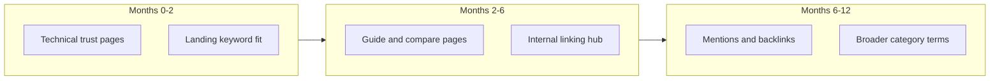

# PlanSage — Organic SEO / AEO strategy

Future-reference strategy for organic search and answer-engine discoverability of PlanSage at [https://todo.sarl/](https://todo.sarl/). **Paid ads are out of scope.**

Audience: humans and AI agents working on marketing pages, public content, or locale work. Product behavior remains governed by [PRD.md](./PRD.md). Performance budgets that affect rankings are in [PERF_TESTING.md](./PERF_TESTING.md).

---

## 1. Purpose and success definition

Google ranks **URLs that match search intent**, backed by relevance, usefulness, technical quality, and authority (links and brand mentions)—not apps that are merely “good.”

**12-month organic goal:** top-3 for PlanSage brand queries plus a cluster of differentiation long-tails (Eisenhower matrix task app, time-budgeted daily planning, 1-3-5 rule workflow).

**Not the near-term goal:** #1 for head terms like “todo app” or “task manager.” Those require years of content and authority; this strategy deliberately defers them.

---

## 2. Current baseline

Brand in UI and SEO is **PlanSage**; primary domain is **`todo.sarl`** (permanent—no dependency on `todo.fr` or other expensive ccTLDs). Always pair them in public copy (“PlanSage (todo.sarl)”) so search associates brand ↔ domain.

| Asset | Location | Role |
|-------|----------|------|
| Landing + FAQ | [`apps/web/src/pages/index.astro`](../apps/web/src/pages/index.astro) | Only strong indexable marketing page today |
| Meta / OG / canonical | [`apps/web/src/layouts/layout.astro`](../apps/web/src/layouts/layout.astro) | Title, description, Open Graph, Twitter, canonical |
| JSON-LD helper | [`apps/web/src/components/seo/json-ld.astro`](../apps/web/src/components/seo/json-ld.astro) | Landing ships `WebSite`, `SoftwareApplication`, `FAQPage` |
| robots.txt | [`apps/web/public/robots.txt`](../apps/web/public/robots.txt) | Allow `/`; disallow app routes; allow major AI crawlers; sitemap URL |
| sitemap.xml | [`apps/web/public/sitemap.xml`](../apps/web/public/sitemap.xml) | Manual; currently only `https://todo.sarl/` |
| llms.txt | [`apps/web/public/llms.txt`](../apps/web/public/llms.txt) | AEO / LLM citation summary |
| Astro `site` | [`apps/web/astro.config.mjs`](../apps/web/astro.config.mjs) | `https://todo.sarl`, `output: "server"` |
| App shell | [`apps/web/src/layouts/app-shell.astro`](../apps/web/src/layouts/app-shell.astro) | Authenticated boards: `noindex, nofollow` |

Auth and app routes (`/today`, `/matrix`, `/tasks`, `/projects`, `/complete`, `/settings`, `/dashboard`, `/onboarding`, auth pages) are disallowed and/or `noindex`. Public crawlable product content is effectively **`/` only**. There is no blog, docs site, about, privacy, or terms page yet. Layout uses `lang="en"`; no i18n framework yet.

Landing document title target (when changing code): **`PlanSage — Get tasks done today`**.

---

## 3. Keyword strategy

### Cluster A — Brand (fastest wins)

- `plansage`, `plansage app`, `todo.sarl`
- Consistent PlanSage ↔ todo.sarl pairing on landing, `llms.txt`, directories, and profiles

### Cluster B — Differentiation long-tails (core growth engine)

| Intent | Example queries | Page type |
|--------|-----------------|-----------|
| Eisenhower + software | “eisenhower matrix todo app”, “urgency importance task manager” | Feature / guide |
| Capacity / overcommit | “time budgeted daily planner”, “daily task capacity limit”, “don’t overcommit todo list” | Feature / guide |
| 1-3-5 method | “1-3-5 rule productivity app”, “1 3 5 task method” | Guide |
| Persona | “todo app for indie hackers”, “task manager for overloaded professionals” | Landing sections / persona pages |
| Problem | “endless checklist overwhelm”, “too many tasks not enough time” | Problem → product |

### Cluster C — Comparison / alternatives (high commercial intent)

- “Todoist alternative for Eisenhower matrix”, “TickTick vs Eisenhower”, “best Eisenhower matrix apps …”
- Honest comparison pages with real screenshots/workflows and clear criteria—not thin affiliate spam

### Cluster D — Defer (year 1+)

- “todo app”, “best task manager”, “asana alternative”
- Only after Clusters A–C have ranking URLs and external mentions

**Default rule:** every new public URL targets **one primary query + 2–3 related questions**, with the answer in the first screenful (AEO-friendly).

---

## 4. Phased roadmap

### Phase 1 — Technical and trust foundation (weeks 1–4)

Keep the existing landing SEO stack; close gaps that block trust and indexing as pages are added.

1. **Trust / legal pages (indexable):** `/privacy`, `/terms`, and later `/about`. Footer links; accurate entity facts (do not imply French SARL registration you do not have).
2. **Sitemap automation:** replace the manual single-URL sitemap with a generated sitemap (Astro endpoint or build step) listing every indexable marketing URL with `lastmod`.
3. **Search Console + analytics (free):** verify `todo.sarl`, submit sitemap, monitor impressions/CTR/coverage. Tag organic landing → signup conversion (Plausible, Umami, or GA4—pick one).
4. **Landing keyword fit:** set title to `PlanSage — Get tasks done today`; add visible H2s aligned with Cluster B (not only `#faq`); keep FAQ + FAQPage JSON-LD; expand FAQs from Search Console / support only. Later, test more query-aligned titles (e.g. Eisenhower / daily capacity) only if CTR is weak.
5. **CWV guardrails:** keep landing in LHCI; respect LCP / island budgets in [PERF_TESTING.md](./PERF_TESTING.md). Do not bloat marketing with heavy islands.
6. **Domain:** treat **`todo.sarl` as the permanent primary domain**. Do not block SEO work waiting on another domain.

### Phase 2 — Content moat (months 2–6)

One indexable URL cannot compete. Ship a small, high-quality public content hub on the same origin (Astro content collection or MDX under `apps/web`).

| URL | Purpose |
|-----|---------|
| `/` | Conversion + brand + product summary |
| `/features/matrix` | Eisenhower / urgency–importance |
| `/features/today` | Capacity budget, workload bar, 1-3-5 |
| `/guides/eisenhower-matrix` | Educational pillar (method → how PlanSage applies it) |
| `/guides/1-3-5-rule` | Educational pillar |
| `/guides/time-budgeted-day` | Educational pillar |
| `/compare/...` | 2–3 honest alternative pages |
| `/blog/...` | Only if cadence is sustainable (≤2 strong posts/month beats 20 thin ones) |

**Content standards (SEO + AEO + EEAT)**

- Answer first, then depth; H2s as questions users actually ask
- Original experience: screenshots/GIFs of Matrix → Today capacity
- Author byline + “last updated”
- Unique title, description, and canonical per URL; Article / HowTo / FAQ JSON-LD where appropriate
- Internal links: guides → feature pages → `/` CTA; features link back to guides
- Update `llms.txt` and the sitemap whenever a public URL ships

**Cadence:** month 2 — three pillar guides + two feature pages; months 3–6 — one comparison or deep guide per month; refresh winners from Search Console.

Do not publish thin “What is a todo list?” posts. Compete where PlanSage is uniquely credible.

### Phase 3 — Authority without ads (months 3–12)

Content stalls without mentions and links. Prefer free / low-cost levers:

1. Indie / builder distribution: Show HN, Indie Hackers, Reddit (value-first), Product Hunt with differentiation (“Eisenhower + daily capacity”)
2. Guest how-tos on Eisenhower / 1-3-5 / capacity planning that link to pillars
3. Free SaaS directories (AlternativeTo, SaaSHub, BetaList, etc.) with consistent brand copy
4. One canonical linkable educational asset (diagram or worksheet) hosted on-site
5. Early-user proof (with permission) on `/` and guides

Avoid link schemes, PBNs, and mass guest-post networks.

---

## 5. Measurement

| Horizon | KPI |
|---------|-----|
| 30 days | Search Console verified; brand query impressions; 0 critical coverage errors |
| 90 days | Top-10 for ≥5 Cluster B long-tails; landing organic CTR trending up |
| 6 months | Top-3 for brand + ≥3 differentiation queries; organic signups attributed in analytics |
| 12 months | Stable Cluster B ownership; footholds in Cluster C; optional limited Cluster D tests |

---

## 6. French i18n and exploiting `.sarl`

### What `.sarl` is (and is not)

- gTLD referring to *Société à responsabilité limitée*; open registration; **not** a French ccTLD like `.fr`
- Google treats new gTLDs like `.com`—**no ranking bonus** for the TLD string
- Does **not** auto-geotarget France; Search Console country targeting is deprecated—locale comes from language, `hreflang`, URLs, and local signals
- For francophones, `todo.sarl` can aid **CTR and trust** (todo + familiar business form), not algorithmic TLD juice
- Risk: users may infer a registered French SARL—state entity facts accurately on About / legal pages

### Benefits of French

| Benefit | Strength | Notes |
|---------|----------|--------|
| French long-tail queries | High | e.g. *matrice d’Eisenhower application*, *gestionnaire de tâches capacité*, *méthode 1-3-5* |
| Francophone markets | Medium–High | FR, BE, CH, CA-QC, parts of Africa—language targeting fits a gTLD |
| Niche FR content scarcity | Medium | Eisenhower + daily capacity angle underserved in French |
| Aligns with `.sarl` brand cue | Medium | Domain + FR copy reinforce each other |
| Full in-app i18n | Lower near-term ROI | Large cost; does not unlock ranking if marketing stays EN-only |

### Chosen approach

1. Keep **English as the primary product locale** until EN niche content (Phase 2) ships and is measured.
2. Add a **French marketing locale** at `https://todo.sarl/fr/` (subdirectory on the same host). Translate landing + winning pillars/features; human-edit machine drafts.
3. Wire **`hreflang`** en ↔ fr (+ `x-default`), unique FR titles/descriptions, `lang="fr"`, FR JSON-LD, sitemap entries for both locales. Explicit language switcher—**no IP-based auto-redirect**.
4. **Exploit `.sarl` without buying `.fr`:** French pages, `hreflang`, FR backlinks, and PlanSage + todo.sarl pairing. Google does not require a `.fr` to rank French content. Do not wait on or budget for `todo.fr`.
5. **Defer full app UI i18n** until FR marketing drives meaningful signups and English-only UI shows clear friction. Then use a real i18n library; keep strings out of hardcoded islands.

### When to skip French for now

- Cannot sustain EN pillar content (FR would double thin surface)
- No capacity for human FR review
- Goal is still ranking English head-term “todo app” (FR will not help that SERP)

### Sequence

Phases 1–2 (EN) first → FR marketing locale after 2–3 EN pillars exist → full in-app FR only after demand is proven.

---

## 7. What not to do

- Do not index authenticated app routes (keep `noindex` / robots disallow)
- Do not chase “todo app” with generic listicles
- Do not buy links or substitute ads for this strategy
- Do not ship dozens of near-duplicate feature pages
- Do not treat SSR as an SEO blocker—keep important copy in initial HTML
- Do not expect `.sarl` alone to rank in France; do not claim SARL legal status you do not have
- Do not wait on `todo.fr` or similar expensive ccTLDs
- Do not ship unreviewed machine-translated FR pages or IP-based locale cloaking/redirects

---

## 8. Repo-aligned implementation order

When executing SEO product work (separate from authoring this doc):

1. Trust pages + footer links on the marketing layout
2. Content collection + two feature + three guide templates (Astro; Preact only if needed)
3. Dynamic sitemap + Search Console
4. Comparison pages + distribution checklist
5. Iterate titles/FAQs from Search Console data
6. After EN pillars exist: `/fr` marketing locale + bidirectional `hreflang` + FR sitemap / `llms.txt`; language switcher; accurate About copy for the `.sarl` brand
7. Only if FR demand justifies it: full app + email i18n

Stay on the current Better-T-Stack / Astro surface (`apps/web`). Matrix / Today product quality remains the substance marketing pages must demonstrate—SEO without a differentiated product will plateau.

---

## 9. Related docs and code

| Resource | Path |
|----------|------|
| Product requirements | [PRD.md](./PRD.md) |
| Perf / CWV harness | [PERF_TESTING.md](./PERF_TESTING.md) |
| Agent routing | [AGENTS.md](../AGENTS.md) |
| Landing | [`apps/web/src/pages/index.astro`](../apps/web/src/pages/index.astro) |
| Layout SEO | [`apps/web/src/layouts/layout.astro`](../apps/web/src/layouts/layout.astro) |
| robots / sitemap / llms.txt | [`apps/web/public/`](../apps/web/public/) |
